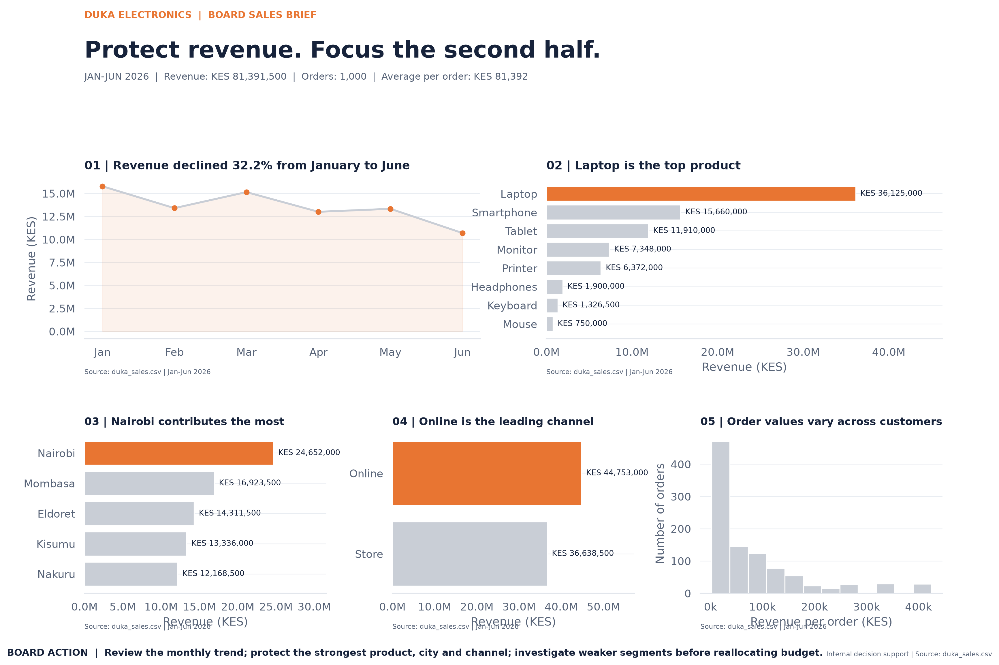

# Duka Electronics Board Report

## Executive Overview

This project analyses Duka Electronics sales data for the period **1 January–30 June 2026**. It converts transaction-level records into business performance indicators, visualisations, and recommendations to support management decisions.

The analysis focuses on revenue performance over time, product contribution, branch and regional performance, sales channels, and customer tiers.



## Board Summary

During the six-month period, Duka Electronics recorded **KES 81,391,500 in revenue across 1,000 orders**, giving an average revenue of **KES 81,391.50 per order**. Revenue declined from KES 15,786,500 in January to KES 10,700,000 in June, a decrease of approximately 32.22%. This trend warrants investigation before management commits additional resources.

Laptops were the leading product category, contributing KES 36,125,000, or 44.38% of total revenue. The online channel generated KES 44,753,000 (54.98%), exceeding store sales. Nairobi was the strongest city, contributing KES 24,652,000 (30.29%). Premium customers generated KES 25,995,500, with a higher average order value than Standard customers.

Management should investigate the revenue decline, protect availability of high-contributing products, evaluate online sales performance, and assess opportunities to improve weaker product categories. These findings describe sales revenue, not profit, and do not establish the causes of the observed trends.

## Business Questions

This analysis addresses the following questions:

1. What were total revenue, order count, and average revenue per order?
2. How did revenue change month by month?
3. Which products contributed the most revenue?
4. How did revenue compare across branches and regions?
5. Which sales channel contributed the most revenue?
6. How did Standard and Premium customer tiers compare?
7. What actions should management consider based on the evidence?

## Key Performance Indicators

| KPI | Result |
|---|---:|
| Total revenue | KES 81,391,500 |
| Distinct orders | 1,000 |
| Average revenue per order | KES 81,391.50 |
| Highest-revenue product | Laptop |
| Laptop revenue | KES 36,125,000 |
| Laptop share of revenue | 44.38% |
| Highest-revenue city | Nairobi |
| Nairobi revenue | KES 24,652,000 |
| Online channel revenue | KES 44,753,000 |
| Online share of revenue | 54.98% |
| January revenue | KES 15,786,500 |
| June revenue | KES 10,700,000 |
| January-to-June revenue change | -32.22% |

## Principal Findings

### 1. Revenue declined over the period

Revenue fell from KES 15,786,500 in January to KES 10,700,000 in June. This is a 32.22% decrease between the two months. Management should investigate changes in demand, stock availability, pricing, promotions, and transaction volume.

### 2. Laptops dominated product revenue

Laptops generated KES 36,125,000, representing 44.38% of total revenue. Management should monitor laptop stock availability and supplier performance while assessing the sustainability of this concentration.

### 3. Online sales led the channels

Online sales generated KES 44,753,000, or 54.98% of revenue, compared with KES 36,638,500 from store sales. Management should evaluate online conversion, fulfilment, customer experience, and operating costs.

### 4. Nairobi led city performance

Nairobi contributed KES 24,652,000, approximately 30.29% of total revenue. The business can investigate which products and customer segments drive this result before transferring successful approaches to other branches.

### 5. Premium customers had a higher average order value

Premium customers generated KES 25,995,500 across 272 orders, while Standard customers generated KES 55,396,000 across 728 orders. The average order value was approximately KES 95,571.69 for Premium customers and KES 76,093.41 for Standard customers. This difference is descriptive and does not prove that customer tier causes higher spending.

## Recommendations

1. **Investigate the revenue decline:** Compare monthly orders, units sold, product mix, prices, stock-outs, and promotions.
2. **Protect leading product sales:** Monitor laptop inventory, supplier reliability, and demand while avoiding overdependence on one category.
3. **Improve channel decisions:** Evaluate online and store sales alongside fulfilment costs, returns, and customer satisfaction.
4. **Learn from stronger locations:** Examine Nairobi's product mix and sales practices before piloting suitable approaches in other branches.
5. **Develop customer strategies:** Test relevant retention and cross-selling activities for Premium and Standard customers and measure the results.
6. **Track performance regularly:** Review revenue, distinct orders, average order value, units sold, and product/channel contribution each month.

## Dataset and Measures

The source file is `duka_sales.csv`.

Expected fields include:

- `order_id` — order identifier.
- `order_date` — transaction date.
- `branch` — branch associated with the sale.
- `product` — product category.
- `quantity` — units sold.
- `customer_tier` — customer classification.
- `channel` — sales channel.
- `unit_price` — recorded unit selling price.
- `city` — city associated with the transaction.
- `region` — geographic region.

**Revenue calculation:** `quantity × unit_price`.

Revenue is calculated at transaction-row level and summed across the relevant rows. Distinct orders are counted using unique `order_id` values. Average revenue per order is total revenue divided by the distinct order count.

## Project Structure

```text
plp-da-a6-duka-board-report/
├── duka_sales.csv
├── run_analysis.py
├── build_notebook.py
├── board_report.ipynb
├── README.md
├── dashboard.md
├── requirements.txt
├── docs/
│   └── methodology.md
├── figures/
│   ├── before.png
│   └── after.png
├── reports/
│   ├── duka_board_report.png
│   ├── board_metrics.json
│   ├── board_findings.csv
│   └── board_summary.md
└── dashboard_screenshots/
    ├── dashboard-overview.png
    ├── dashboard-breakdowns.png
    └── README.md
```

Additional chart files may be present in the project directory.

## Installation and Execution

Use Python 3 and PowerShell.

1. Open the project folder in VS Code or PowerShell.
2. Create and activate a virtual environment if one is not already active:

```powershell
python -m venv .venv
.\.venv\Scripts\Activate.ps1
```

3. Install dependencies:

```powershell
python -m pip install -r requirements.txt
```

4. Run the analysis:

```powershell
python run_analysis.py
```

5. Open the notebook:

```powershell
jupyter notebook board_report.ipynb
```

If Jupyter is not available as a command, run:

```powershell
python -m notebook board_report.ipynb
```

Run the notebook cells in order. Keep `duka_sales.csv` in the project root unless the analysis code specifies another location.

## Dashboard Evidence

The project includes dashboard screenshot evidence in `dashboard_screenshots/`. See [Dashboard Documentation](dashboard.md) for the KPI definitions, visualisations, filters, and evidence files.

A public dashboard URL has not been included in this README. Add the actual published URL if the assignment requires one.

## Quality Checks

The analysis should be checked for:

- Missing values and duplicate records.
- Valid dates and positive quantities and unit prices.
- Consistent revenue calculations.
- Correct order counts and aggregate totals.
- Agreement between reported metrics and visualisations.
- Clear labels, currency units, and date ranges.

The current analysis recorded 1,000 transaction rows over 1 January–30 June 2026, with no missing values, duplicate full rows, duplicate order IDs, invalid dates, or non-positive quantities or unit prices.

## Limitations

- The dataset covers six months only; it does not establish long-term seasonality.
- Revenue is not profit. Product costs, operating expenses, returns, and margins are not included in the reported revenue measure unless separately provided.
- Observed differences and trends do not establish causation.
- Results depend on the completeness and accuracy of the supplied dataset.
- Recommendations should be tested against additional operational and financial evidence.

## Deliverables

This project brings together the source dataset, analysis script, notebook, report outputs, figures, dashboard evidence, and documentation. The public repository and any required hosted dashboard should be verified before final submission.

## Author

Prepared as a data analytics board-report project for Duka Electronics.
